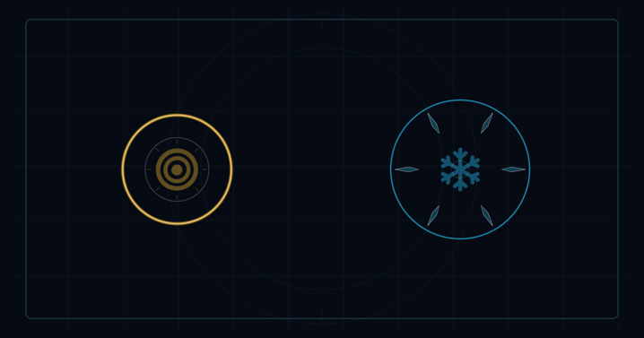
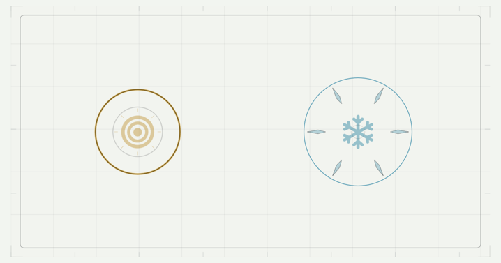

Tilt Arena response-time decisions — 9 September 2026

**Adopt responsive Shockwave/Freeze fronts and a 0.4-second Power charge as local defaults.** Keep weapon radii, freeze duration, Shockwave hold time, and both wave lifetimes unchanged. Physical-phone acceptance and full-run economy comparisons remain open.

The initial 1,032-case matrix showed that Power had no kills under the two aggressive scripts and that defensive waves often failed to help immediately after collection. A focused approaching-chaser fixture reproduced death with both original waves and survival with responsive fronts. Their old linear base-front speeds were 150 points/s for Shockwave and 175 for Freeze, below the craft's 263.2 points/s maximum. A player could leave the useful wave area before it intercepted a closing enemy.

The first response trial shortened Shockwave expansion to 0.24 seconds and Freeze expansion to 0.35 seconds. It improved many cases, but review found five additional Shockwave collision endings and six additional Freeze collision endings. Later entrants missed effects that now ended too soon. Those duration candidates were rejected; their [864-case results](2026-09-09-response-results.md) remain recorded.

The accepted curve is `radius = maximumRadius × (1 − (1 − elapsed / duration)^3)`, clamped to [0, maximumRadius]. It starts quickly and eases toward the final boundary over the original duration. At every instant its coverage is at least the old linear coverage; its reach and expiration time are identical. A shared bounded exponent in the tuning catalog controls both waves. Collision fronts and visible boundary animations call the same progress function, with the activation's configuration explicitly passed to the visuals.

| Change | Paired cases | New collision endings | Eliminated collision endings | Mean change in observed time, capped at 18 s |
|---|---:|---:|---:|---:|
| Responsive Shockwave front | 144 | 0 | 22 | +2.95 s |
| Responsive Freeze front | 144 | 0 | 44 | +7.80 s |
| Power charge 0.6 → 0.4 s | 144 | 0 | 9 | +1.26 s |

See the [accepted-front comparison](2026-09-09-wavefront-results.md) and [raw results](2026-09-09-wavefront-encounters.json). Each weapon's pairs cover eight fixtures, three movement scripts including deliberate slow aiming, two seeds and all three tiers. These correlated scripted cases are not human effect-size estimates. Earlier frozen enemies can thaw earlier, and earlier kills can change splitter/score timing; the results establish that the specific tested regressions were removed, not that every possible trajectory improves.

Power's deliberate aiming regression passes at 30/60/120 Hz: both original and shorter charges clear targets, and the shorter charge retains at least as many kills in that fixture. It still fires in the direction at release. The initial no-kill outcome was therefore a failure under aggressive approach timing, not a broken Power resolver.

The front tests verify coverage never drops below the old curve, the lifetime remains equal at 30/60/120 Hz, late entrants remain eligible, and the visible action follows the collision curve. Captured 0.2-second visuals were inspected in both themes:

Rules version is now 2. Development profiles require that rules version and reset when missing or incompatible; there is no migration or grandfathered score/progression. No external Game Center data or App Store Connect configuration was changed.

The review also corrected the tuning subgroup expectation and added a previous-rules-profile reset test. Final regression validation executed 612 tests, with three opt-in sweeps skipped and zero failures; lint and whitespace checks passed. Existing static snapshots remained unchanged. These captures and renderer tests do not establish physical tilt comfort or crowded-device performance.

Reproduce the accepted response matrix with `TEST_RUNNER_TILT_RESPONSE_SWEEP=1` and the `ArenaBalanceEncounterTests` test class. Export `testExportResponseTimeComparisons()` and summarize its `wavefront-encounters.json` attachment using `scripts/summarize-weapon-balance --response --front`. The harness pins pre-experiment values explicitly so adopting a default does not change the reference side of the comparisons. The rejected duration matrix is reproduced by selecting `.fastShockwave` / `.fastFreeze` in the same paired cases.

Freeze's proposed 8-second duration was rejected under the old slow-front baseline. The accepted response curve improves Freeze substantially, so that earlier result alone cannot decide its final duration. Recheck duration with the responsive front before closing the lifetime question. Flame's shorter burst, Nova banking, scoring, pacing and unlock timing still need their separate comparisons.
