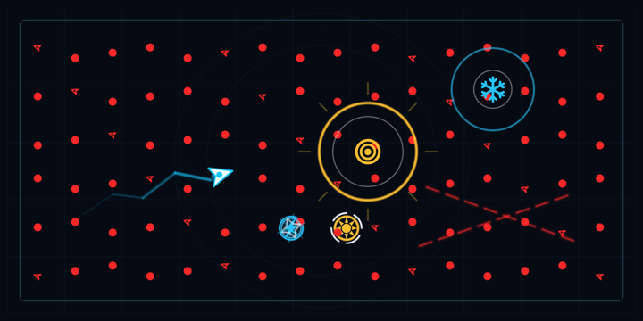
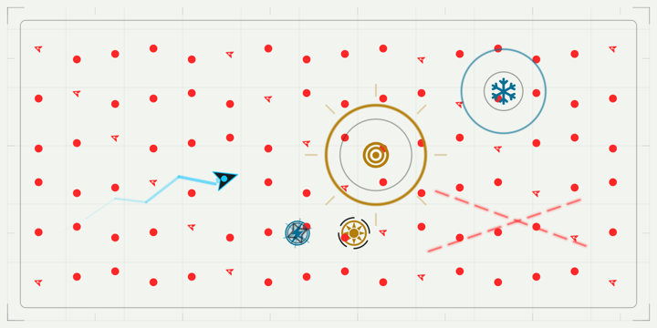
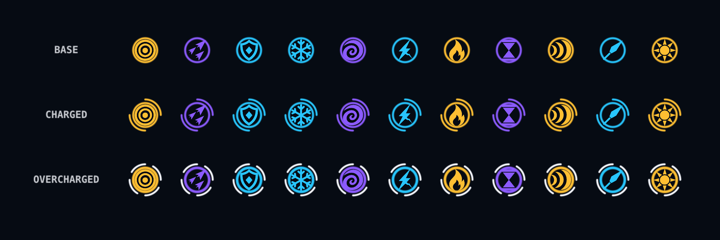
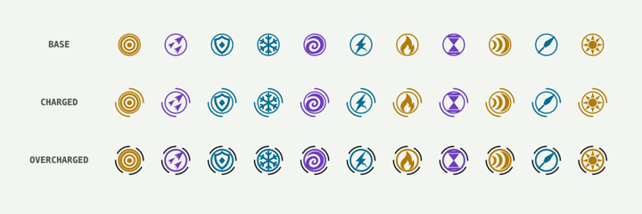

# Approved gameplay visual pass

Implemented 2026-09-09 after the user accepted the recommended direction.

## What changed

- Quieter grids, two faint outer radar rings, shorter boundary ticks and a
  calmer center. Both dark and white themes remain available.
- Sharper player outline and a shorter, more tapered cyan trail.
- Solid enemy silhouettes with fewer outlines. Mine/splitter identity and
  frozen, thawing and split-protection states retain their distinct markers.
- Eleven matching weapon glyphs generated with built-in `image_gen`.
  Pickups have one steady rim; charged and overcharged pickups use two and
  four outer arcs respectively. The white theme uses darker weapon colors.
- Open shockwave/freeze fronts, shorter peripheral spokes and lower-opacity
  area fills. Activation glyphs are capped at 64 points so coverage geometry,
  player and threats remain readable.
- The weapon codex uses the same symbols and colors as gameplay.

Attack ranges, timing, collision geometry, scoring and logical target selection
are unchanged. The sixteen-target visual impact budget remains unchanged.

## Generated asset

- [Selected alpha atlas](../../../TiltArena/Resources/Assets.xcassets/WeaponGlyphs.imageset/weapon-glyphs-v2.png)
- [Production prompt and iterations](production-prompt.md)

White-image exports were rejected for background artifacts. The final PNG is a
1254 × 1254 black silhouette atlas with real alpha, copied into the workspace
without pixel edits. The texture loader renders its alpha mask white once and
caches it for SpriteKit color multiplication. Measured 300-pixel crops center
the glyphs without cutting edges or sampling neighbors. The unused original
weapon sprite sheet was removed from the app bundle; it remains in Git history.

## Validation

- Debug simulator build succeeded on iPhone 16 Pro / iOS 18.5.
- Full test suite after review: **534 tests, zero failures**, with snapshot recording off.
- SwiftLint passed with no warnings; `git diff --check` passed.
- Updated 27 existing image baselines and added five: both themes' complete
  pickup charge states, both crowded gameplay scenes and white effect coverage.
- The atlas test checks every crop for meaningful foreground, transparent
  gutters and absence of an opaque background.
- Visually reviewed the rendered dark/white gameplay, charge states, actor
  sheet, effects, menu and codex. Fixed tint and legacy enemy-ring issues found
  during this review before accepting the baselines.
- Interactively checked both themes in Simulator through the menu, calibration,
  a short live run with moving enemies and charging pickups, and the run-over
  screen. Returned to the dark-theme home screen afterwards. These brief runs
  do not establish physical-device performance or validate every weapon in motion.

The final review result bundle is `/tmp/tilt-visual-review-final-20260909.xcresult`.
Its build and test log is `/tmp/tilt-visual-review-final.log`.

## Review fixes

- Assigned explicit drawing depths to pickup glyphs, enemy markers and player
  details. The app enables SpriteKit's sibling reordering, so equal depths could
  let opaque fills obscure details. A rendered comparison failed in both themes
  before the fix and passes after reversing child insertion order with the fix.
- Snapshot rendering now defaults to the app's sibling-reordering setting.
- Replaced parallel atlas arrays with one weapon-to-center mapping, removed
  unused frozen-halo assignments and removed the obsolete bundled sprite sheet.
- Kept the atlas pixel buffer pinned for the entire Core Graphics draw in the
  asset regression test.
- Rechecked state transitions, pickup charging callers, effect coverage and
  all texture consumers. The final pass found no further actionable issues in
  the visual changes.

## Reviewed renders

