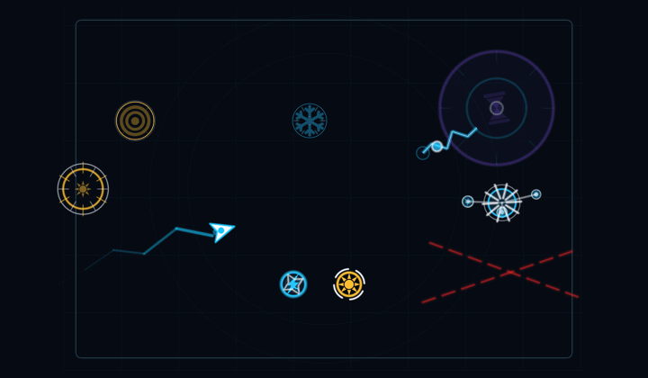
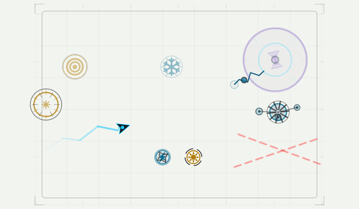

# Effect playback references

Simulator captures of both themes with several weapon effects staged together.
These illustrate animation and overlap; they are not gameplay or performance
benchmarks.

To capture fresh previews, set `TILT_RECORD_EFFECT_PREVIEWS=1` in the test process
environment and run
`ArenaEffectSnapshotTests.testEffectsFinishPlaybackWithoutLeavingNodes`.
The test attaches GIFs to the result bundle and verifies transient effect nodes
are removed. Normal test runs skip GIF capture.
